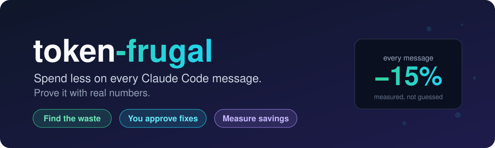
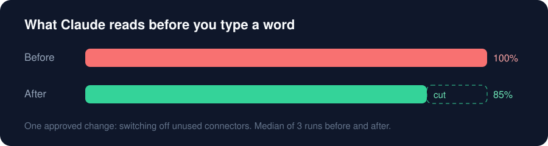

<p align="center">
  
</p>

<p align="center">
  <a href="LICENSE"></a>
  
  
  
</p>

<h3 align="center">Your Claude Code sessions are carrying weight you never asked for.<br>token-frugal finds it, cuts it with your approval, and shows you the receipt.</h3>

---

## Why it matters

Every message you send to Claude Code also sends a hidden bundle: instructions, memory, tool lists, connectors. You pay for that bundle **on every single turn**. When it's bloated, you get:

- 💸 **Higher bills**, or faster hits on your plan limits
- 🧠 **Shorter sessions** before Claude has to compact and forget
- 🤔 **Confused answers**, from old or conflicting rules buried in your files

## The result

<p align="center">
  
</p>

One change, approved in a single "yes", made **every message about 15% lighter** for good. Measured with real sessions, not estimated.

## How it works

```
  1. FIND            2. FIX                 3. PROVE
  ─────────          ─────────              ─────────
  Audits your        Shows the exact        Runs real before/after
  instruction        diff. Nothing          sessions and tells you
  files, memory      changes until you      if the saving is real
  and tools.         say yes. Backup        or just noise.
                     kept, always.
```

## What you can ask it

> **"Why is my session so expensive?"**
> Ranks what's taking up space, by real measured usage.

> **"Check my CLAUDE.md files."**
> Finds broken imports, duplicate lines, dead links and rules that contradict each other across folders.

> **"What if I turned off the Figma connector?"**
> Tests it in a throwaway session first. Your settings are untouched.

> **"Is that tip from Reddit true?"**
> 22 popular tips, each with a trust score. Three common myths are busted with sources.

> **"How much have I saved so far?"**
> A running savings history across all your projects.

## Install

In Claude Code:

```
/plugin marketplace add shelmecha/token-frugal
/plugin install token-frugal@token-frugal
```

Start a new session and type `/token-frugal:token-frugal`, or just ask a question above.

<sub>Needs Node.js 18+. Measuring uses the `claude` CLI on your PATH.</sub>

## Built to be trusted

| Promise | How it keeps it |
|---|---|
| Never edits behind your back | Every change is a diff you approve. A backup is kept. |
| Never guesses | Every number is labelled **measured**, **estimate** or **unknown**. |
| Never oversells | Small savings are called small. Noise is called noise. |
| Sources, not vibes | Answers link to the official Claude Code docs. |
| Stays quiet | A once-a-day check speaks up only when something is wrong. Turn off with `TOKEN_FRUGAL_NUDGE=off`. |

<details>
<summary><b>For developers</b></summary>

- Data (proposals, backups, history) lives in `~/.cache/token-frugal`. Override with `TOKEN_FRUGAL_DATA`.
- To audit several projects at once, copy `config.example.json` to `~/.cache/token-frugal/config.json`.
- Run locally: `claude --plugin-dir .`
- Tests: `node --test tests/*.test.js`

</details>

---

<p align="center"><sub>MIT licensed · Made for people who'd rather spend tokens on answers</sub></p>
